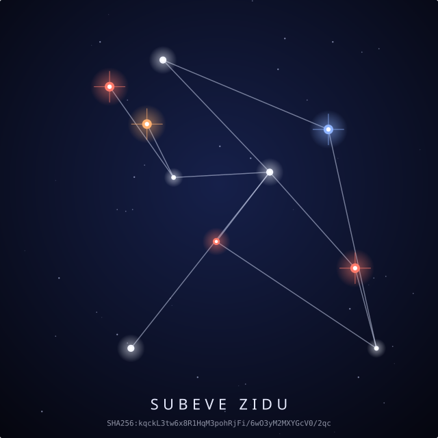

# Stellar

Stellar draws a public key as a constellation, so that people can compare two keys by looking at a small sky instead of reading 43 characters of base64.



It is a visual fingerprint, like OpenSSH randomart. It is **not** a cipher and it is not a new cryptosystem: all the security comes from the SHA-256 digest of the key, and Stellar only changes how that digest is shown. The project is unrelated to the Stellar payment network.

Status: prototype. The mapping is versioned (`v1`) but may still change.

## Build

Stellar needs Go 1.24 or later and has no dependency outside the standard library. Without Go, `make image` builds everything in a container, with Podman or Docker (see [Container](#container)).

```sh
go build -o bin/stellar ./cmd/stellar
go test ./...
```

## Usage

```sh
stellar ~/.ssh/id_ed25519.pub        # an OpenSSH public key
stellar cert.pem                     # a PEM certificate or public key
stellar -host example.com            # the certificate a TLS server presents
stellar SHA256:kqckL3tw6x8R1Hq...    # a fingerprint someone sent you
cat key.pub | stellar -              # standard input
```

By default the constellation is drawn in the terminal:

```
┌─[ stellar v1 ]─────────────────────────┐
│             *⣶⠤⣄⡀                      │
│        ✦     ⠈⠳⣄⠉⠓⠲⢤⣀                  │
│        ⠹⣄      ⠈⠳⣄  ⠈⠉⠓⠦⣄⣀             │
│         ⠘⢦ ✦     ⠈⢧⡀     ⠈⠙⠲⠤⣄⡀        │
│          ⠈⠳⣷⡀      ⠙⢦⡀        ✦        │
│            ⠙⣷⡀       ⠙⢦⡀      ⠸⡄       │
│             ⠈•⠒⠒⠒⠒⠒⠒⠒⠒⢒⡿*⣄     ⣇       │
│                      ⣠⠞⠁ ⠈⢳⡀   ⢸       │
│                    ⢠⡾⠃     ⠙⢦⡀ ⠈⡇      │
│                   *⠋         ⠙⢦⡀⢹      │
│                 ⢠⠞⠙⠲⣄⡀         ⠳⣜⡆     │
│               ⢀⡴⠋    ⠙⠲⣄⡀       ⠈✦     │
│              ⣠⠞         ⠙⠲⣄⡀     ⢹⡄    │
│            ⢀⡞⠁             ⠙⠲⣄⡀  ⠈⣇    │
│           ⡴⠋                  ⠙⠲⣄⡀⢹⡀   │
│          *⠁                      ⠙⠺•   │
└─[ Subevia Zidensis ]───────────────────┘
Name:        Subevia Zidensis
Fingerprint: SHA256:kqckL3tw6x8R1HqM3pohRjFi/6wO3yM2MXYGcV0/2qc
Key:         test@stellar (ssh-ed25519)
```

| Flag | Effect |
| --- | --- |
| `-o file.svg` | Write an SVG instead of drawing in the terminal (`-o -` for standard output). |
| `-size 640` | Width and height of the SVG, in pixels. |
| `-host name[:port]` | Fetch the key from a TLS server. The port defaults to 443. |
| `-insecure` | With `-host`, skip certificate verification. |

Colours are disabled when the output is not a terminal or when `NO_COLOR` is set.

## Website

`stellar serve` runs a small website: type a host name, see the sky of the key its certificate carries.

```sh
make serve                # builds the image in a container, then http://localhost:8099
stellar serve -addr :8080 # or straight from the binary
```

| Route | Purpose |
| --- | --- |
| `/` and `/?host=example.com` | The page. A whole URL may be pasted; only its host name is kept. |
| `/sky/example.com.svg` | The constellation as an image, to embed elsewhere. `?size=` sets its side, from 64 to 2048 pixels. |
| `POST /key` | The constellation of a pasted public key, certificate or fingerprint. |
| `/healthz` | Liveness probe. |

**Remembering a sky.** The page stores, in the visitor's browser only (`localStorage`), the fingerprint each host showed last. On a later visit it says whether the sky is the same or has changed. A change is not proof of an attack: many sites generate a new key at every certificate renewal, so their sky changes every few weeks. Sites that keep their key across renewals keep their sky.

**Sharing a sky.** Once a sky is drawn, a "Send on Threema" link opens Threema with a message naming the host, its sky and its fingerprint, to edit before sending. It is a plain link: nothing loads from Threema until someone clicks. Start the site with its public address (`stellar serve -url https://stellar.example`, or `make serve URL=…`) and the message ends with a link back to the sky; without it, the message carries no link.

**What the server agrees to connect to.** The site connects to hosts named by strangers, so it is restricted:

- Only DNS names are accepted: no IP address, no port, no single-label name. The port is always 443.
- The address actually dialled is checked after name resolution and must be public. Loopback, private, link-local, carrier-grade NAT, NAT64 and 6to4 ranges are refused, whatever the DNS answers.
- The certificate chain is verified. A key that cannot be verified is not drawn.
- At most 16 lookups run at once, each within 8 seconds. Results are cached for 5 minutes.
- Errors shown to visitors never echo the underlying network error.

There is no per-visitor rate limit: put the site behind a reverse proxy that has one before exposing it to the internet.

The pages load nothing from other origins and carry no inline script or style, under a `default-src 'none'` content security policy. The typefaces (Bricolage Grotesque and IBM Plex Mono, both under the SIL Open Font License) are served by the site itself; see `web/static/fonts/NOTICE.txt`.

### Container

```sh
make test    # format check, vet and tests, inside the build stage
make image   # the image: a static binary and the root certificates, about 9 MB
make serve   # run it, read-only, without capabilities, on 127.0.0.1:8099 (PORT=… to change)
make sky HOST=example.com
```

The image is built `FROM scratch` and runs as an unprivileged user. Go is only needed inside the build stage, so a workstation with a container engine needs nothing else.

**Podman or Docker.** Both work, with the same `Dockerfile` and the same commands. The Makefile uses Podman by default; pass `ENGINE=docker` to use Docker:

```sh
make serve ENGINE=docker
```

Without `make`, the two commands are:

```sh
podman build -t stellar .                          # or: docker build -t stellar .
podman run --rm -p 127.0.0.1:8099:8080 stellar     # or: docker run  --rm -p 127.0.0.1:8099:8080 stellar
```

## What is hashed

| Input | Digest |
| --- | --- |
| OpenSSH public key | SHA-256 of the key blob. This is the fingerprint `ssh-keygen -l` prints. |
| PEM public key, PEM certificate, TLS host | SHA-256 of the DER `SubjectPublicKeyInfo`. |
| `SHA256:` fingerprint | The fingerprint itself. |

A certificate and the public key it certifies give the same constellation. A renewed certificate keeps its constellation for as long as it keeps its key.

Stellar refuses private keys.

## Names

Every sky has a name, such as *Subevia Zidensis* or *Merebis Vovinus*. The names are **invented**: they are derived from the key, like the stars, and none is the name of a real constellation. The drawings do not match real constellations either.

They are built to sound like the Latin names astronomers use (*Corona Borealis*, *Piscis Austrinus*): a noun with a Latin ending (`-us`, `-ia`, `-ix`…) followed by an epithet (`-alis`, `-ensis`, `-inus`…). The point is a name that can be said aloud, over the phone or across a desk: "on my side your site is Merebis Vovinus; and on yours?"

Real constellation names would not do. There are 88 official ones, so unrelated keys would share a name all the time, and making a key that is called *Orion* like yours would take a few dozen tries. The invented scheme has about 8.4 billion names (33 bits). That makes an accidental match unlikely; it does not stop someone who searches for one on purpose (see [Limits](#limits)).

The names have no meaning in Latin, and no care is taken to make noun and epithet agree.

## Limits

- **The fingerprint is the authority.** A constellation carries fewer bits to the eye than the digest holds. Someone who can generate many keys can search for one whose constellation resembles yours. Use the drawing to notice a change quickly; compare the full fingerprint when it matters.
- **The name alone is weak.** It holds about 33 bits, and a matching name can be found by brute force in minutes. Never accept a key on its name only.
- **The terminal view is a subset.** It shows the main stars and the edges, not the background stars.
- **The website sees the key from where the server sits.** It shows the key the site presented to the Stellar server, not the one it presented to your browser. Someone intercepting your own connection is not visible from there. To check what your machine receives, run the command line locally: `stellar -host example.com`.
- **`-insecure` shows what the network presents.** Without verification, the key may come from anyone on the path.
- **No human study has been run.** How reliably people tell two constellations apart is not measured yet.

## Algorithm (v1)

The mapping from digest to constellation is deterministic. All integers below are drawn, in the order given, from one stream.

**Stream.** SHAKE256 absorbs the 11 bytes `stellar/v1\0` followed by the 32-byte digest. To draw a uniform integer in `[0, n)`, read 2 bytes as a big-endian integer `v`; if `v >= 65536 - (65536 mod n)`, discard it and read again; otherwise return `v mod n`.

1. **Name.** Two words. The noun is a consonant, a vowel, a consonant, a vowel, a consonant and a noun ending. The epithet is a consonant, a vowel, a consonant and an epithet ending. Consonants are drawn from `bdfghjklmnprstvz` (`draw(16)`), vowels from `aeiou` (`draw(5)`), noun endings from `a us um is ix or ax ia` (`draw(8)`), epithet endings from `alis aris ensis inus ianus osus atus icus` (`draw(8)`), each list indexed from 0. The first letter of each word is capitalised.
2. **Star count.** `n = 7 + draw(6)`, so 7 to 12 main stars.
3. **Main stars.** Until `n` stars are placed: draw `x = draw(64)` and `y = draw(64)`. If the point is closer than 9 grid units to a star already placed (squared distance below 81), discard it. Otherwise draw `magnitude = draw(3)` and `class = draw(5)` and place the star. Magnitude 0 is the brightest; classes run from blue (0) through white, yellow and orange to red (4).
4. **Tree.** For each star `i` from 1 to `n-1`, sort the stars placed before it by increasing squared distance to `i`, ties broken by lower index. Star 1 joins star 0. Every later star joins candidate number `draw(2)` of that list.
5. **Loops.** Draw `k = draw(3)`. Repeat `k` times: draw `a = draw(n)` and join `a` to the nearest star it is not already joined to (same ordering as above). If there is none, do nothing.
6. **Background.** Draw `m = 40 + draw(24)`. For each of the `m` background stars draw `x = draw(256)`, `y = draw(256)` and `brightness = draw(3)`.

Rendering is not normative, but a `v1` renderer must show every main star with its position, magnitude and class, and every edge.

`TestGolden` pins this mapping, and `testdata/v1.json` lists the constellations of 32 digests in full: another implementation of v1 must reproduce every entry. A change that alters the output for an existing digest must bump the version, in the domain separator as well as in `Version`.

## Library

```go
key, err := stellar.Parse(data) // or ParseSSH, ParsePEM, ParseFingerprint, FromHost
c := stellar.New(key.Digest)

fmt.Print(c.Text(true))               // terminal
svg := c.SVG(640, key.Fingerprint())  // SVG document
```
